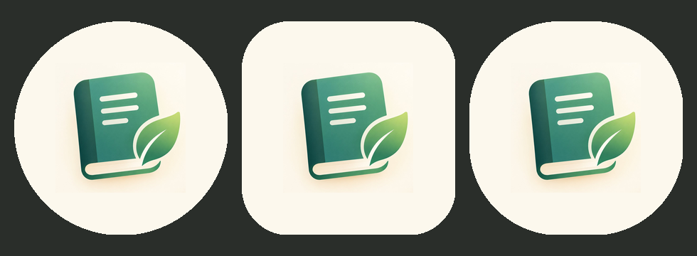

# 拾页 · Shiye

一款**本地优先**的个人日记 Android App：日记、记账、灵感三件事放在一起，
数据只存在手机本地，不注册、不登录、不上传、不埋点。

<p align="center">
  
</p>

> 设计（视觉、交互、功能口径）由作者完成，代码由作者与 AI 结对编写。
> 详见文末「关于这份代码的来历」。

## 功能

### 日记

- 模板制：字段可自定义（单行 / 多行 / 必填），预置「日常」与「每日复盘」两套模板
- 写作时自动保存（防抖 + 串行写入，不会把半截内容写进库）
- 「补写回忆」可以回到过去某一天补记
- 全文搜索，结果高亮；支持批量删除
- 导出为可阅读的 Markdown 文件（走 SAF，不需要存储权限）

### 记账

- 流水记录：金额一律按「分」存整数，不用浮点数
- 账户与分类管理；账户余额 = 期初 + 收入 − 支出，不落库，永远对得上
- 借款单独建表，**不计入收支**
- 「补账单」可补记过去某天；首页只显示最近几天，行尾带时间
- 统计页：按周期看分类占比；关键词搜索命中备注 / 分类名 / 账户名

### 灵感

- 分页收纳的碎片想法，可整页检索
- 与日记、记账一样支持多选删除

### 备份与设置

- 一键完整备份为 ZIP，可从备份恢复（恢复前先解析摘要，二次确认）
- 浅色 / 深色 / 跟随系统
- **可选 AI**：默认关闭；关闭时不读配置、不发请求、UI 里不出现入口

## 隐私

- 数据默认只存在 App 私有目录的 Room 数据库里，不联网同步
- 只申请一个权限：`INTERNET`（用于可选的 AI 功能）。没有存储权限（读写文件走 SAF），
  没有网络状态权限，没有统计 / 广告 / 崩溃上报 SDK
- `android:allowBackup="false"`，不参与系统云备份
- AI 的 API Key 存在 `EncryptedSharedPreferences`（Android Keystore 保护），
  不写进代码、不进备份文件

## 可选的 AI

默认关闭。开启后可以：

- 连任意 **OpenAI 兼容**接口（云端 API，或本机 Ollama / LM Studio 的 `http://<局域网IP>:端口/v1`）
- 多套配置档案，每个档案单独存 Key；档案列表本身不含 Key
- 对当前日记做润色 / 总结；采纳前先判冲突，替换留快照可撤销
- AI 产出单独存到 `ai_notes`，不混进正文

局域网连本机模型的步骤见 [`本地部署连接教程.md`](本地部署连接教程.md)。

## 技术栈

| 层 | 选型 |
|---|---|
| 语言 | Kotlin |
| UI | Jetpack Compose + Material 3 |
| 数据库 | Room + SQLite（schema 导出在 `app/schemas/`，迁移有校验） |
| 异步 | Coroutines + Flow / StateFlow |
| 序列化 | kotlinx.serialization |
| 网络（仅 AI） | OkHttp |
| 依赖注入 | 手写容器 `AppContainer`，不引 Hilt |
| 导航 | 自写状态机，每个 Tab 一条独立返回栈 |

工具链按开发时的版本锁定：**AGP 9.1.1 / Gradle 9.3.1 / Kotlin 2.3.10 / KSP 2.3.6 /
Compose BOM 2026.09.00 / minSdk 26 / targetSdk 36 / compileSdk 37**。
其中 AGP 9 内置 Kotlin 支持，构建脚本里有几处非标准写法，改之前先读
[`gradle/libs.versions.toml`](gradle/libs.versions.toml) 顶部的说明。

## 构建

需要：JDK 21、Android SDK Platform 37（含 build-tools）、Android Studio（可选）。

```bash
# 1. 指向你的 SDK（不要提交这个文件）
echo "sdk.dir=/path/to/Android/Sdk" > local.properties

# 2. 编译 + 跑单测
./gradlew :app:assembleDebug
./gradlew :app:testDebugUnitTest      # 250+ 个 JVM 单测
```

第一次构建会由 Gradle Wrapper 自动下载 Gradle 9.3.1。
release 包默认不签名：

```bash
./gradlew :app:assembleRelease
```

## 项目结构

```
app/src/main/java/com/shiye/journal/
├── data/           # Room 实体、DAO、Repository、备份编解码、预置数据
├── domain/         # 纯 Kotlin 业务规则（日期、金额、模板切换、搜索高亮、AI 摘要……）
├── ui/             # Compose 页面、组件、ViewModel、主题
├── features/ai/    # 可选 AI：配置、凭据、协议、HTTP 出口、错误翻译
├── navigation/     # 自写导航状态机
└── util/
app/schemas/        # Room 各版本 schema（迁移校验用）
docs/               # 阶段记录、性能优化与回滚说明
local_diary_ui_prototype.html   # 最初的 HTML 界面原型
完整项目内容.txt     # 需求与规格说明
```

## 文档

- [`docs/PROGRESS.md`](docs/PROGRESS.md) — 分阶段改动清单、构建结果、踩过的坑
- [`docs/PERF-ROLLBACK.md`](docs/PERF-ROLLBACK.md) — 启动性能优化做了什么、怎么回滚
- [`完整项目内容.txt`](完整项目内容.txt) — 需求规格

## 关于这份代码的来历

这个项目是**人机协作**的产物：

- 需求、功能口径、视觉与交互设计由作者确定（`local_diary_ui_prototype.html` 是最初的设计原型）；
- 代码由 AI 助手按阶段生成，作者负责定方向、验收、在真机上测试并决定取舍；
- 每一阶段的改动、失败的尝试和结论都记在 `docs/PROGRESS.md` 里。

如果你打算把这个项目用于自己的作品集，建议也如实标注 AI 参与的部分。

## 许可证

[MIT](LICENSE)
